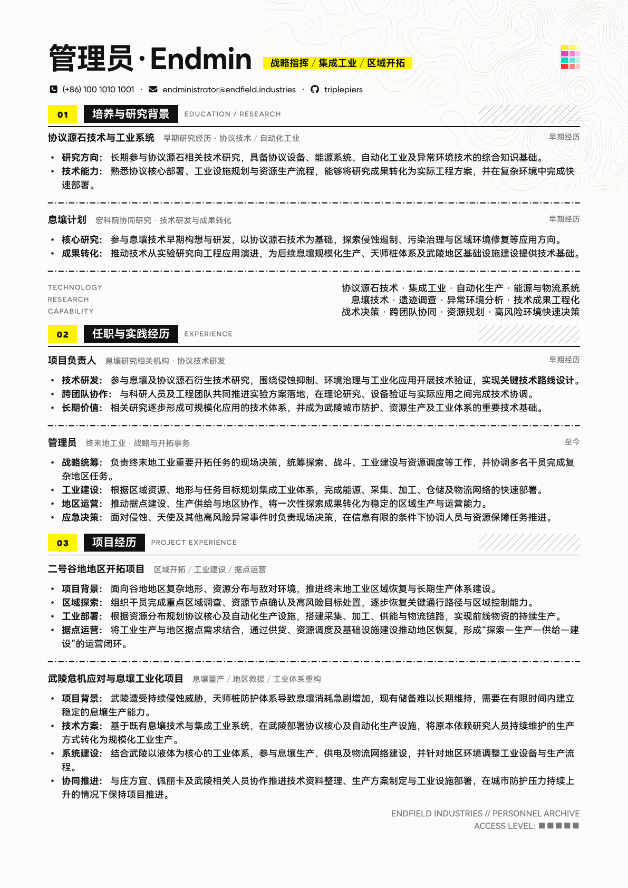
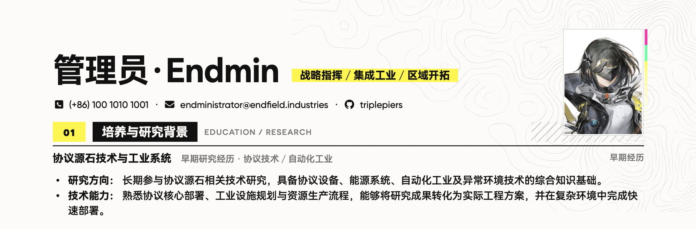

# Endfield CV, but Typst!

一份[终末地](https://endfield.hypergryph.com)风味的中文简历模板

## Preview



### DLC 1 - Photo

现已支持证件照（但是会压到第一个 section 的分割线 omo）



## Usage
> Typst Web 编辑器项目：[EndField_CV_Template](https://typst.app/project/rysGx9Z8lm01X9BS7t12gS)
>
> - ⚠️ 这是一份 READ-ONLY 示例，使用前需要在 [首页](https://typst.app/) Duplicate 一份可写副本
> - Web 端与本地编译结果可能存在差异（导致跨页）

- 文件结构

  ```
  .
  ├── assets        # 图片资源
  ├── fonts         # 用到的字体
  ├── template.typ  # 模板定义
  └── main.typ      # <= 这里写正文
  ```

- 本地编译：输出为 `main.pdf`

  ```bash
  typst compile --font-path ./fonts main.typ
  ```

## Components

### ⚠️ Header (已重构)

支持设置照片、姓名、标签和联系方式

```typst
#header(
  photo_path: none, // "assets/photo.jpg"
  name: "管理员·Endmin",
  tags: "战略指挥 / 集成工业 / 区域开拓",
  phone: "10010101001", 
  email: "endministrator@endfield.industries",
  github: "triplepiers",
)
```

- 照片（photo_path）

  - 设置为 `none` 时，不展示照片
  - 设置为 <u>相对图片路径</u> 时，展示照片、且略微增大页面上边距

      默认为 3 寸照片比例，理论上会自动裁切/拉伸、并居中显示

- 姓名和标签

  - `name`：加粗的大名，支持中英文
  - `tags`：黄色背景的 tag，可以自定义分隔符

- 联系方式：不需要的可以设置为 `none`

  - 手机号会格式化成 `(+86) xxx xxxx xxx`
  - GitHub <u>只需要填用户名</u>

### Section

- 标题：自动编号，需传入 "中文 - 英文标题"

  ```
  #section("培养与研究背景", "EDUCATION / RESEARCH")
  ```

- 内容：<u>每段经历</u> 需要单独的 entry，需传入 "岗位名称 - 公司/概述 - 时间"

  ```
  #entry(
    "协议源石技术与工业系统",
    "早期研究经历 · 协议技术 / 自动化工业",
    "早期经历"
  )[
    - *研究方向：* 长期参与协议源石相关技术研究，具备协议设备、能源系统、自动化工业及异常环境技术的综合知识基础。
    - *技术能力：* 熟悉协议核心部署、工业设施规划与资源生产流程，能够将研究成果转化为实际工程方案，并在复杂环境中完成快速部署。
  ]
  ```

- （可选）手动分割线：是虚线、上下留白可以自己调

  ```
  #v(0.2em)
  #line(length: 100%, stroke: (dash: (5pt, 2pt, 1pt, 2pt)))
  #v(0.2em)
  ```

- （可选）技能列表：两栏、详情右对齐，需传入 "技能标签 - [概述]"

  ```
  #skill-list((
    (
      label: "TECHNOLOGY",
      content: [协议源石技术 · 集成工业 · 自动化生产 · 能源与物流系统],
    ),
    ...
  ))
  ```

### Footer (保密等级标识)

```
#footer(access-level: 5)
```

- 支持通过 `access-level` 参数（1~5）定义保密等级（影响方块数量）

- 注意
  
  - 参与整体文档流定位（不是固定在右下角的绝对定位）

  - 每一页得手动添加（是的，很呆）


### 证件照（可选，仅首页）

照片是可选项，在 `header` 的 `photo_path` 设置路径，默认 `none`：

```typst
#header(
  photo_path: "assets/photo.jpg",
  name: "姓名",
  tags: "标签",
)
```

- `photo_path` 支持项目中的本地图片路径（例如 `assets/photo.jpg`）。Typst 的 `image` 不会直接从 URL 下载图片；Web 编辑器项目请先上传照片资源，再使用其项目路径。
- 照片固定在首页右上角，默认 `24mm × 32mm`，使用白色底框并避开首页开头的正文区域。
- 有照片时页面顶部留白为 `18mm`，无照片为 `15mm`。
- `fit: "cover"` 会保持照片比例并居中填满框，超出部分自动裁剪，无需额外 Python 脚本。
- 当前照片模式会隐藏姓名行右侧原有的彩色标记，并保留原背景纹理；P2/P3 装饰资源到位后可替换该区域。建议使用竖版证件照。
- `phone`、`email`、`github` 全部为 `none` 时，Header 仅在整体底部添加 `3pt` 间距；只要有一项联系方式，就在姓名区与联系方式间及 Header 底部各添加 `3pt` 间距。
